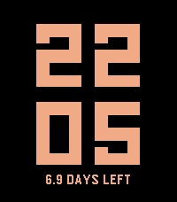
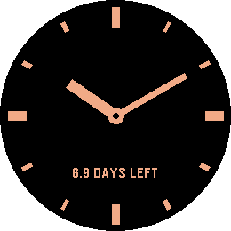

# Coast

*The watchface that barely wakes up.*

     

A Pebble watchface (v1.4.0).

Most watchfaces redraw the screen every minute. A face with a second hand
redraws it 86,400 times a day. Coast redraws it 288 times - and if you ask
it to, only 96.

It does that by rounding. The time steps in five minute intervals, and
between two steps nothing on screen changes, so nothing is drawn - not the
digits, not the background, nothing. No second hand, no sweeping animation,
no minute that ticks over just to prove the watch is awake.

You choose which way it rounds. Down shows the step you have passed, so the
time is never ahead of itself. Up shows the step that is coming, which keeps
you running a few minutes early - useful if you are the sort who is always
catching the train by a hair.

There is no Bluetooth traffic while it runs. No weather to fetch, no
timeline to sync, no phone to wake. Nothing is subscribed to the
accelerometer or the heart rate sensor. The backlight is never switched on
by the face itself. What is left is the smallest amount of work a watchface
can do and still tell you the time.

Two styles, same principle. Digits sets the time in LECO 1976, the geometric
numerals the Pebble was always associated with, drawn far larger than the
built-in version allows - two lines, hours above minutes, filling the
display. Hands is a bare dial of twelve marks and two flat hands. The minute
hand jumps from mark to mark like a station clock, so the rounded time is
simply where the hand stands. Neither style costs more to draw than the
other.

Alongside the time, Coast tells you what all of this buys you. It measures
how fast your watch actually discharges and turns that into the days you
have left - not a percentage you have to interpret, but a number you can
plan around.

That number gets better the longer you wear the watch. The first estimate
arrives after a single percentage point of discharge, which makes it early
but rough. Every measurement after that is folded into the figure, and the
later ones are taken over longer stretches, so the estimate stops moving and
settles. After a few days it is no longer a rule of thumb but a reading of
your watch in particular - your notifications, your backlight, your time out
of Bluetooth range. Until that very first measurement is in, the line simply
shows the charge level.

Both colours are yours. Pick a background and a colour for the digits or the
dial; if you happen to pick the same one twice, the watch quietly
substitutes something you can read. Night mode simply trades the two,
between an hour you set in the evening and an hour you set in the morning,
so a bright face turns dark for the night and back again on its own.

Runs on every Pebble: the original Pebble and Pebble Steel, Pebble Time,
Pebble Time Steel, Pebble Time Round, Pebble 2, Pebble Time 2 and Pebble
Round 2. Each display size gets its own layout, and on the black and white
models the two colours simply become black and white.

A note on the rounded time: Coast is deliberately not accurate to the
minute. Rounding down, 11:07 shows 11:05; rounding up, it shows 11:10, and
with hands the minute hand points at the mark it belongs to. If you need the
exact minute at a glance, this is the wrong watchface - and that is the
whole point of it.

## Settings

- Style - Digits or Hands.
- Update step - 5 or 15 minutes. The displayed time is rounded to this step.
  Fifteen minutes redraws the screen 96 times a day instead of 288.
- Rounding - down to the step you have passed, or up to the one coming.
- Background - the face colour.
- Digits and hands - the colour of the numerals or the dial, and the battery
  line.
- Show runtime estimate - turn the battery line off entirely for the barest
  possible face.
- Swap colours at night - trades the two colours between the hours you set.
- Night begins / Day begins - any full hour, listed in both 24 hour and
  AM/PM form. Set both to the same hour to leave the colours alone all day.

12 or 24 hour format follows the watch setting; there is nothing to
configure.

## Platforms

- Pebble Time 2 (`emery`)
- Pebble Round 2 (`gabbro`)
- Pebble Time Round (`chalk`)
- Pebble Time (`basalt`)
- Pebble 2 (`diorite`)
- Pebble 2 Duo (`flint`)
- Pebble / Pebble Steel (`aplite`)

## Building

With the [Pebble SDK](https://developer.repebble.com/sdk/):

```bash
pebble build
pebble install --emulator emery
```

The repository can also be imported into CloudPebble as is.

## Release notes

### 1.4.0

Coast now runs on the older watches as well - the original Pebble and Pebble
Steel, Pebble Time and Time Steel, Pebble Time Round and Pebble 2. Each
display size has its own layout, and the numerals are set at a size those
watches can render.

### 1.3.0

Rounding can now go up instead of down, so the time runs a few minutes ahead
and you arrive early. New night mode swaps the background and digit colours
between two hours you choose, with no extra drawing and no sensors - it is
simply the same two colours the other way round.

### 1.2.0

New Hands style: a dial of twelve marks with a minute hand that jumps from
mark to mark in the chosen step. Switch between Digits and Hands in the
settings; colours, battery estimate and update step apply to both. With
hands, the runtime line moves out of the way of the hands.

### 1.1.1

The first runtime estimate now appears after a single percentage point of
discharge instead of three. On a watch that lasts a long time a percentage
point can stand for most of a day, which meant the estimate stayed hidden
for days. Later measurements still average over longer stretches.

### 1.1.0

First release.
